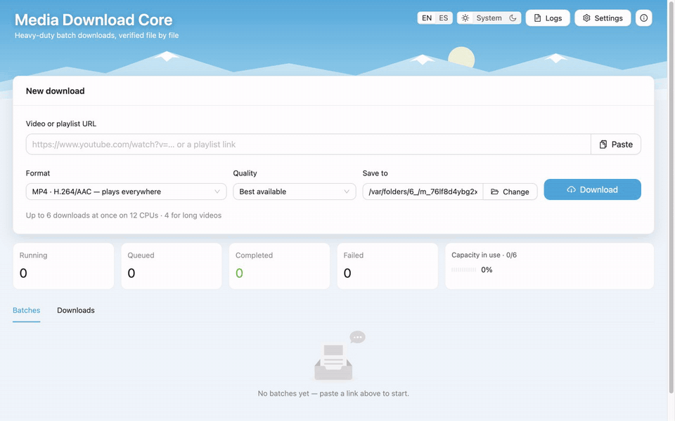
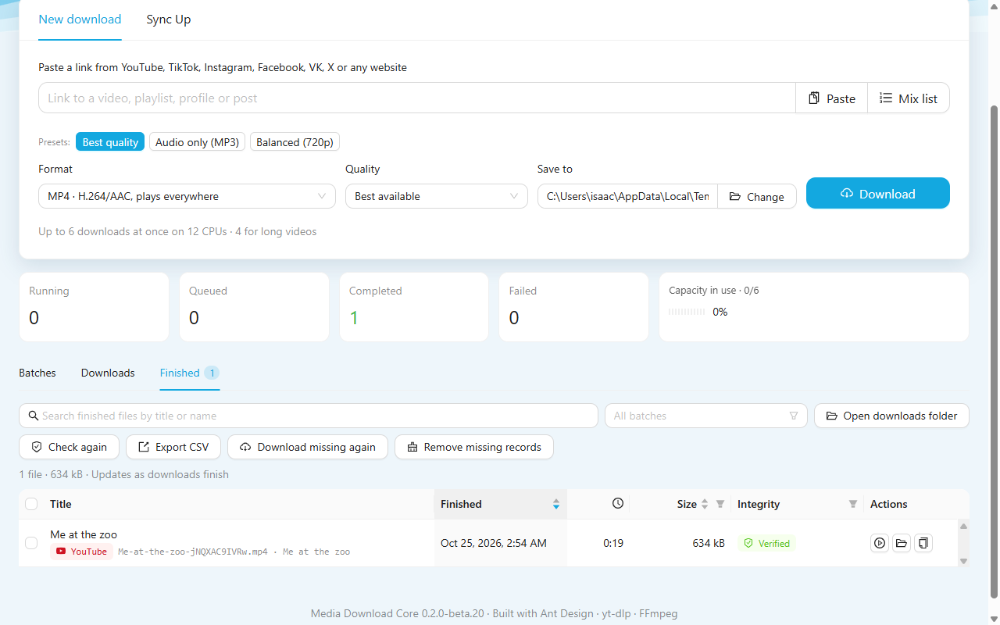
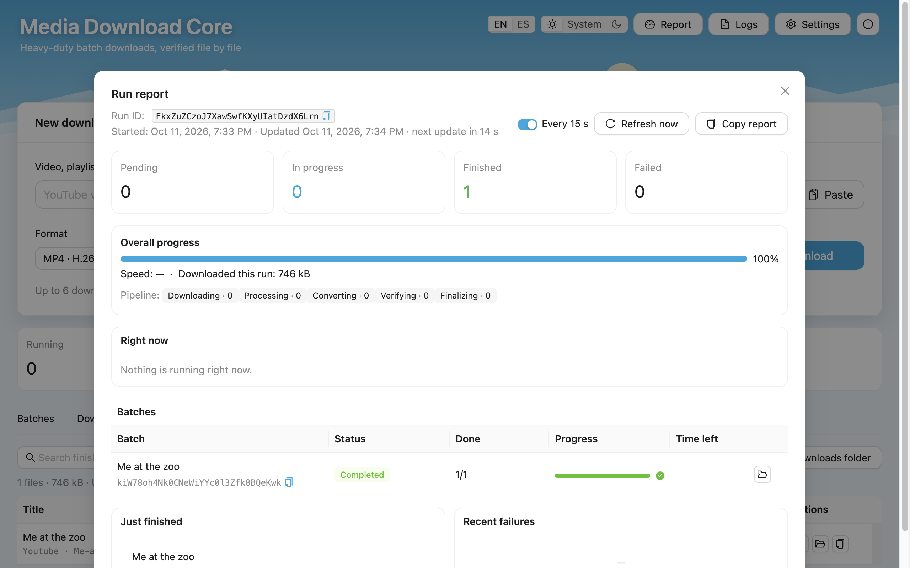
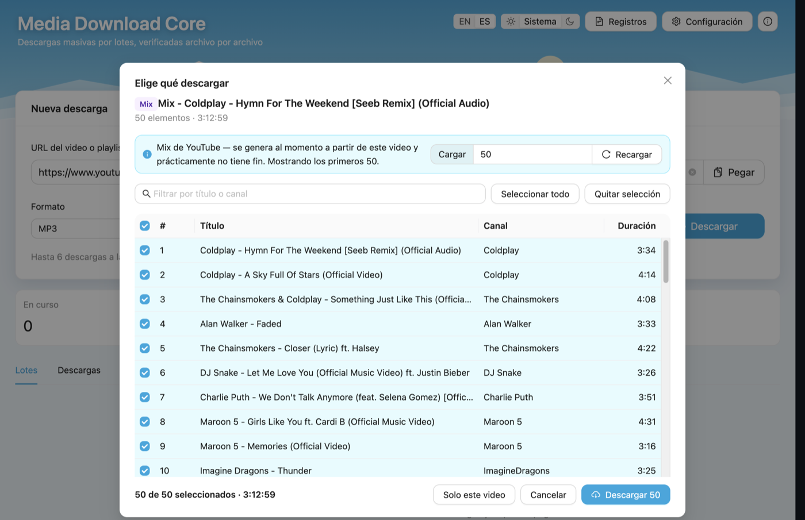
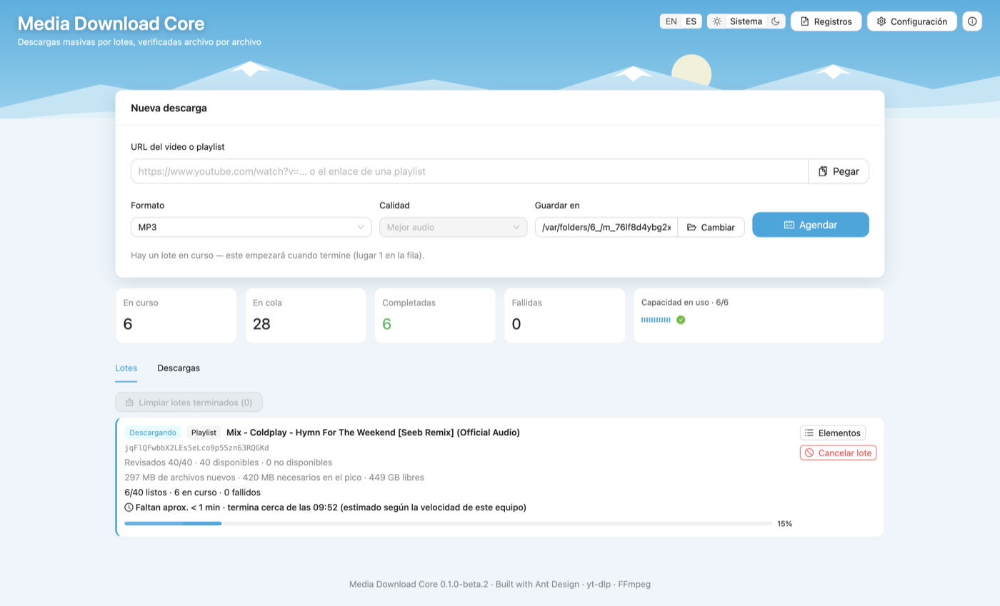
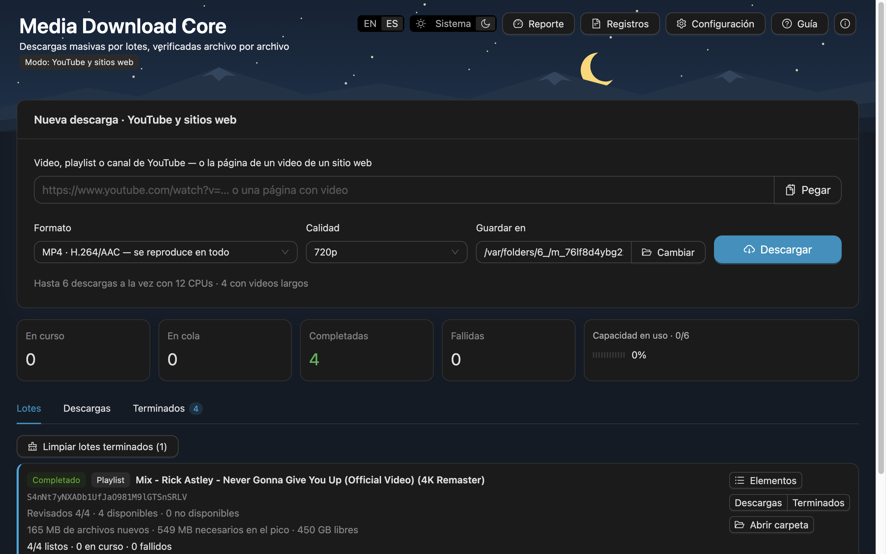

# media-downloader-core

**A download engine built for heavy workloads — not one video, many:**
playlists with thousands of items, batches queued back to back, hours of
unattended backup. Every hot path is O(1) or O(n) by design, work runs on a
⌊CPUs/2⌋ pool of processes and threads so the machine stays responsive,
memory stays flat, and **every file is validated** before it's delivered.

UI-agnostic — drive it from the `mdc` CLI, the [desktop app](#desktop-app-beta),
an Electron main process or a server. Zero runtime dependencies: it
orchestrates `yt-dlp`, `ffmpeg` and `ffprobe`, and installs/verifies them
itself (`mdc setup`).

> **Educational project.** It is meant for learning and for backing up content
> you own or are allowed to download. Respect each site's terms of service and
> copyright law; you are responsible for how you use it. Some parts exist to
> study how sites tell their own pages from scripts — notably
> [YouTube's attestation](#youtube-attestation), which YouTube's terms don't allow
> outside its page.

```bash
npm install media-downloader-core     # the library (Node 20+), ESM and CommonJS, types included
npm install -g media-downloader-core  # …or the `mdc` command line
```

```ts
import {MediaDownloader} from 'media-downloader-core'

await using dl = new MediaDownloader({dataDir: '/path/to/app-data'})
dl.on('job', job => console.log(job.status, job.progress.fraction))

const result = await dl.analyze('https://www.youtube.com/playlist?list=…')
if (result.kind === 'playlist') dl.addPlaylist(result, {kind: 'audio', container: 'm4a'}, '/Users/me/Music')
await dl.whenIdle()
```

## Desktop app (beta)

[`app/`](app) is a desktop front end for macOS and Windows: Electron, React and
[Ant Design](https://ant.design). Paste a video or playlist link, pick a format
and a quality, and the batch is checked, forecast for disk space, downloaded on
the ⌊CPUs/2⌋ pool and verified file by file.

**Website: [isaachq.github.io/media-downloader-core](https://isaachq.github.io/media-downloader-core/)** — every feature, how it works, and the right installer for your computer.



### What's new in beta 9

- **Player-page links on any site** — a search or video page from a site whose videos each have a page with a player now works without adding the site to `sites.json` first: any link yt-dlp doesn't support is tried as a player page, whatever its host. No site is named in the app. [How it works](#player-page-sites-configured-locally).

### In beta 8

- **YouTube's "confirm you're not a bot", one step at a time** — nothing changes until YouTube refuses. Then the app retries with verification tokens it makes itself (no window, nothing to do); if YouTube still refuses, YouTube downloads stop and wait — not failed — and the app says why and lets you choose: sign in to YouTube inside the app, use a browser's session, or wait. Then everything goes on from where it was. [How it works](#youtube-when-it-asks-to-confirm-youre-not-a-bot).
- **No more Keychain prompts one after another** (macOS) — a browser's cookies are read once for a whole batch, not by every download.
- **A YouTube account inside the app** — only when YouTube requires it and you agree; the sign-in stays in the app, used for YouTube only. Settings shows it and signs it out.
- **For learning: YouTube's attestation** — how a site proves the client streaming from it is its own page, and how the app takes part (PO tokens). Checked every day by a workflow that opens a pull request, in English and Spanish, when YouTube changes it. [Read more](#youtube-attestation).
- **Fixes** — a download cancelled just before it started now really stops; on Windows, updating an install for everyone asks for an administrator's permission through the app's own prompt.

### In beta 7 (7.2)

- **The Windows update, fixed** (7.2) — the app hands the update to the installer's own update mode, for the scope the app was installed for (asking for permission only when it must); if an update doesn't go in, the next start says so. Tested by installing and updating the app on a real Windows machine.
- **YouTube's "confirm you're not a bot", handled** (7.1) — checks and downloads ask YouTube politely; when it blocks the connection anyway, YouTube downloads pause together and try again by themselves, and a banner offers to go on at once with your browser's signed-in session. [How it works](#youtube-when-it-asks-to-confirm-youre-not-a-bot).
- **Sync Up** — keep TikTok accounts in step with their folders: next to New download, add an account (its folder may already hold its videos), and each sync downloads only what the folder is missing, as a regular batch — now, daily at a time, or every few hours. A folder keeps one format: one with MP4 files gets MP4. Also from the command line (`mdc sync`) and any scheduler. [How it works](#tiktok-sync-sync-up).
- **Retry what failed, and see why** — each batch tells why items failed (removed, private, network…) and retries them in one click; the run report retries every batch.
- **One batch at a time** — Downloads and Finished filter by batch (Finished, across sessions); a batch card opens them filtered. Finished also checks files again, exports a CSV and forgets entries.
- **TikTok slideshows** — as an MP4 (N seconds per image, over the soundtrack), as images with their sound, or images only; with an audio format, just the soundtrack.
- **Several links at once** — paste or drop a list; each link becomes a batch.
- **Notifications outside the app** — a system notification when a batch ends in the background; progress on the Dock / taskbar icon.
- **First steps** — a three-step guide on the first launch (Header → Guide replays it).

### In beta 6

- **Finished tab** — every finished file of every session: search, play, show in its folder; verified, missing or changed at a glance.
- **Run report** — the run ID and everything in flight, refreshed every 15 seconds, copyable as text.
- **TikTok** — profiles that count posts they don't list say so; veteran profiles list back to their musical.ly-era posts.
- **A website** — [isaachq.github.io/media-downloader-core](https://isaachq.github.io/media-downloader-core/), in English and Spanish.

| Finished tab | Run report |
| --- | --- |
|  |  |

### In beta 5

- **Whole TikTok profiles** — the preview tells how many posts a profile has and offers **Load all (N)**, listed in chunks of 500 that are never lost.
- **Files dated by publication** — sort a folder by date and it sorts by publication.
- **Sites you configure yourself** in a local `sites.json` ([details](#player-page-sites-configured-locally)); an MP4 is kept byte for byte and only validated.

### In beta 4

- **TikTok behind its verification page** — the app opens the page in its own hidden, sandboxed browser, where TikTok's check passes by itself, and carries on over plain HTTP.
- **Progress while a link is read** — "150 of 500 items", with Cancel; a profile listed in the last 15 minutes reopens instantly.

### In beta 3

- **TikTok, built in** — paste a video, a short link (`vm.tiktok.com/…`) or a whole profile (`tiktok.com/@user`, up to 500 posts by default) and pick what to back up from the preview.
- **Car & USB friendly names** — `001-Cancion-Nandu-k1gsZ.mp3`: letters, numbers and hyphens only, and MP3 tags in ID3v2.3, the version car stereos read.
- **Updates inside the app** — a banner announces a new version; one button downloads it, checks it against GitHub's SHA-256, installs it and restarts.
- **Linux** — `.deb`, `.rpm` and AppImage for x64 and ARM; **Windows** setup survives antivirus locks; **macOS** builds are signed ad hoc so they run on Apple Silicon.
- Remembered window size, a start-up screen with retries, an estimated time left per batch, and the first language that matches your system (Spanish or English).

The full list is in the [changelog](CHANGELOG.md).

*A real run: paste a link → MP4 (H.264/AAC) → every frame decoded and checked → integrity report → the file in Finished, ready to play → the run report.*

| Preview of a YouTube Mix | Downloading, with the estimated time left |
| --- | --- |
|  |  |



### Installing

Download the installer for your system from the
[releases page](https://github.com/isaachq/media-downloader-core/releases).
On first launch the app installs yt-dlp and FFmpeg from their official sources
(checksum-verified). The betas are not signed with an Apple or Microsoft
certificate yet, so the system warns the first time; this is expected.

**macOS** (Apple Silicon and Intel) — `.dmg`

1. Open the `.dmg` and drag **Media Download Core** to **Applications**.
2. Open the app. macOS says *"Apple could not verify 'Media Download Core' is
   free of malware…"* — click **Done**.
3. Go to **System Settings → Privacy & Security** and click **"Open Anyway"**
   next to the message about Media Download Core. Confirm with your password.
4. From then on it opens normally.

**No "Open Anyway" button?** (it doesn't always show up, and right click → Open
no longer skips the warning on macOS 15 and later) Run this once in **Terminal**
— it removes the "downloaded from the internet" mark from the app, nothing else:

```bash
xattr -dr com.apple.quarantine "/Applications/Media Download Core.app"
```

**Windows** (x64 and ARM) — `.exe`

1. Open the `.exe`. If a blue window says *"Windows protected your PC"*
   (SmartScreen), click **More info**.
2. Click **Run anyway**. The installer opens, finishes by itself and starts the app.

> **Why the warning?** This is a free project made at home, and the installer
> isn't signed with a paid Microsoft certificate yet. SmartScreen warns about
> that missing signature, not about the file: the code is public here, and
> Windows stops asking as more people install it.

**Linux** (x64 and arm64) — pick your distribution's package:

```bash
# Ubuntu / Debian            (ARM: …-linux-arm64.deb)
sudo apt install ./Media-Download-Core-<version>-linux-amd64.deb
# Fedora / RHEL / openSUSE    (ARM: …-linux-aarch64.rpm)
sudo dnf install ./Media-Download-Core-<version>-linux-x86_64.rpm
# then open it from the app menu, or
media-download-core
```

The `.deb` adds an AppArmor profile on Ubuntu 24.04+ so Chromium's sandbox
can run (24.04 restricts the user namespaces it needs). The `.AppImage` runs on
most other distributions (`chmod +x` it first; Fedora needs `sudo dnf install
fuse-libs` for it); on Ubuntu 24.04+ prefer the `.deb`.

Settings, tools and the download history live in `~/Library/Application Support/Media Download Core`
(macOS), `%APPDATA%\Media Download Core` (Windows) or `~/.config/Media Download Core` (Linux),
shared with the `mdc` command line.

### Updates

The app checks this project's releases at start-up and every 6 hours (Settings →
"Check for updates automatically"; About → "Check for updates" any time). When a
new version is out, one button downloads it in the background, verifies it and
restarts into it; running downloads continue after the restart.

| | Installs by |
| --- | --- |
| macOS | swapping the app bundle once the old one has quit, then reopening it (the app must be in a folder you can write to, e.g. Applications) |
| Windows | running the installer silently, which starts the new version |
| Linux AppImage | replacing the file, then starting it |
| Linux `.deb` / `.rpm` | the system package manager, through your desktop's password prompt |

Only files from this repository's releases are accepted, and only when their
size and SHA-256 match what GitHub publishes for them; on macOS the new bundle
must also be this app, at the offered version, with a valid signature.

### Features

- **Preview**: a playlist, YouTube Mix or channel opens a list of everything it holds first — filter, select all / some, or just the linked video — and only the picked items are downloaded. A Mix (an endless, auto-generated radio) loads its first 50 by default; load more from the preview.
- **Sync Up** (turn it on in Settings): TikTok accounts kept in step with folders — check what is new without downloading, sync now or on a schedule, a history of every run; each sync is a batch in Batches / Downloads / Finished.
- **Batches**: preflight (available / unavailable with the reason), disk forecast from real bitrates, progress weighted by size and the **estimated time left** — measured from this computer's real throughput, so you can start a big batch and walk away — plus paged item list, cancel, clear finished. New links queue behind the running batch.
- **Downloads**: one row per job with progress, speed, ETA, the D·C·V·F sub-tasks (failed / in-progress / success), retries and their reason.
- **Integrity**: the verdict of every file, with codecs, decoded vs expected duration and SHA-256 one click away.
- **Settings**: download folder, simultaneous downloads (capped at ⌊CPUs/2⌋), integrity level, long-video threshold, browser cookies, tags and cover art, notifications.
- **Logs**: live, every line with its batch / job / attempt / step ids (click one to trace it), plus tracing of any session / batch / job / attempt / step id.
- **Car & USB friendly names** (default): only letters, numbers and hyphens — `001-Cancion-Nandu-k1gsZ.mp3` — and MP3 tags in ID3v2.3, the version car stereos read. Switch it off in Settings to keep titles as they are.
- **Setup**: first launch installs yt-dlp and FFmpeg from their official sources, checksum-verified; the tools are shared with `mdc`.
- English and Spanish, light / dark / system theme, window size and position — all remembered.
- A start-up screen shows each phase; a failing phase is retried and, if it still fails, says why and resumes from there.

### Building from source

```bash
cd app
npm install
npm run dev        # development, hot reload
npm test           # UI tests (Vitest + Testing Library)
npm run test:e2e   # the real Electron app end to end (Playwright, fake tools)
npm run dist:mac   # dist/*.dmg + *.zip (arm64, x64)
npm run dist:win   # dist/*.exe installer (x64, arm64)
npm run dist:linux # dist/*.AppImage + *.deb + *.rpm (this machine's architecture; .rpm needs rpmbuild)
```

The interface is built with [Ant Design](https://github.com/ant-design/ant-design)
(MIT) — thank you to the Ant Design team for an excellent, free component library.

## Command line: `mdc`

```bash
npm install -g media-downloader-core     # or: npx mdc …
mdc setup                                # install + verify yt-dlp and ffmpeg (SHA-256, codec check)
mdc doctor                               # tools, versions, codecs, data folder, free space
mdc info  "https://youtube.com/playlist?list=…"
mdc get   "https://youtube.com/playlist?list=…" -f m4a -i 1-20 -o ~/Music
mdc get   "https://youtu.be/…" -f mp4 -q 1080
mdc logs  <id>                           # replay a session / job / attempt / step from the trace logs
mdc verify                               # re-hash every archived file
mdc sync add @name --folder ~/TikTok-name --daily 08:00   # keep an account in step with a folder
mdc sync run --due                       # the syncs whose time has come (cron, launchd, Task Scheduler)
```

A live dashboard shows each job's progress, speed, retries and sub-task
track (`D✓ C– V▸ F·` = download, convert, validate, finalize). `--json`
streams NDJSON for scripts. Exit codes: 0 ok · 1 some downloads failed ·
2 usage · 3 environment not ready · 130 interrupted (partial downloads are
kept and resume next time).

The CLI and the desktop app share one data folder (tools, archive, logs):
`~/Library/Application Support/Media Download Core` (macOS),
`%APPDATA%\Media Download Core` (Windows), `~/.config/Media Download Core` (Linux).

## Setup sources

| Tool | Source | Verification |
|---|---|---|
| yt-dlp | official GitHub releases (onedir builds) | `SHA2-256SUMS` of the release |
| ffmpeg / ffprobe — macOS | Martin Riedl static builds (arm64, x64) | per-file `.sha256` |
| ffmpeg / ffprobe — Windows, Linux | BtbN static GPL builds (latest stable) | `checksums.sha256` of the release |

After extraction every binary must run and ffmpeg must provide the encoders,
decoders and muxers the profiles need (libx264, libvpx-vp9, libopus,
libmp3lame, AV1 decoding…), or the install is rejected and nothing changes.

## Scheduling: schedule → batch → jobs

```ts
import {BatchScheduler, MediaDownloader} from 'media-downloader-core'

const engine = new MediaDownloader({dataDir})
const scheduler = new BatchScheduler(engine)        // maxActiveBatches: 1
await scheduler.restore()                           // batches pending at last shutdown
scheduler.on('batch', batch => render(batch))       // status, preflight, counts
scheduler.schedule({url, profile, outDir})          // never blocks — waits its turn
```

Submitting a url never blocks and never overloads the machine. Each url
becomes a **batch**; batches run one at a time (configurable) and each fans
out into jobs on the ⌊CPUs/2⌋ pool:

1. **checking** — the url is resolved and every item is checked in parallel
   (bounded by the same pool). The metadata fetched here is handed to the
   jobs, so nothing is extracted twice — downloads start immediately.
2. **running** — one job per downloadable item. Unavailable items are closed
   right away with a reason and an actionable hint (`private`, `removed`,
   `geo-blocked`, `needs-sign-in` → "use --cookies", …).
3. **closed** — `completed`, `completed-with-errors`, `failed` or
   `cancelled`, with a report of what couldn't be downloaded and why; then
   the next scheduled batch starts.

Before a job gives up it tries alternatives: fresh extraction for expired
links, and the best available format when the requested resolution doesn't
exist (`format-fallback`, recorded in its attempt history). Pending batches
are saved and resumed by `restore()` after a restart.

**Pick before downloading.** `engine.analyze(url, {maxEntries})` lists a
playlist without extracting each item; pass the entries the user picked as
`selection` and the batch downloads exactly those, without listing the url
again — stable even for lists that change between calls:

```ts
const list = await engine.analyze(url, {maxEntries: 200})
if (list.kind === 'playlist') {
  const picked = list.entries.filter(entry => wanted.has(entry.id))
  scheduler.schedule({url, profile, outDir, selection: {title: list.title, entries: picked}})
}
```

`maxItems` caps a list (listed by yt-dlp itself, so the rest is never fetched).
A **YouTube Mix** (`list=RD…`, see `isYouTubeMix()`) is an endless radio that
yt-dlp would paginate into the thousands, so it defaults to 50.

## YouTube: when it asks to confirm you're not a bot

Many requests in a short time — a 50-video Mix checked at once, its list
reloaded a few times — can make YouTube answer *"Sign in to confirm you're
not a bot"* to every request from your connection, for a while (minutes to
hours). It is not the videos: tried on a real case, every YouTube client
yt-dlp can use was refused just the same. The engine climbs a ladder, one rung
at a time and only as far as needed — nothing changes until YouTube refuses:

| Rung | What happens |
| --- | --- |
| Asking politely (always) | Checks of YouTube videos pause between requests (`--sleep-requests 0.75`, yt-dlp's own "sleep" pace); download attempts start a second apart; a check never mixes YouTube and other sites in one yt-dlp run. |
| 1. Refused once | The error is `blocked` with hint `bot-check` — not `unavailable`. With a host that can mint them (the app), YouTube requests carry **PO tokens** ([below](#youtube-attestation)) and try again after 15 s, 1.5 min and 5 min. Those retries don't count against a download's own retries. |
| 2. Still refused | With a host that can ask the user (`askUser`), YouTube requests **stop and wait** — not failed — and the `youtube` event says so: the app explains why and offers to sign in, to use a browser's session, or to wait 30 min. Once the user chooses, everything goes on from where it was. Without one, the pauses grow 5 → 10 → 20 min (up to 60). |
| 3. Signed in | `setYouTubeAccount(cookiesTxt)`: YouTube runs only use that session. In the app it lives in its own partition — never a browser's store, never the Keychain — and the engine gets a private cookies.txt of YouTube's and Google's cookies only. |

A browser's session (`setCookiesFromBrowser('chrome')`, `mdc --cookies <browser>`)
also goes on at once. Its cookies are **read once** into a private jar (again
after 6 h, or another browser) and every yt-dlp run gets its own copy: on macOS,
one Keychain prompt — not one per process, which a batch of 50 used to raise
one after another. Safari's cookies live in a protected folder: the app (or the
terminal running `mdc`) needs Full Disk Access. Unreadable cookies fail as
`cookies-unreadable`.

## YouTube: attestation

> **For learning.** This part exists to study how a site tells its own web
> page from a script — attestation, PO tokens — and how a download tool can take
> part in it. Running YouTube's attestation outside its page is against
> YouTube's terms of service. Use it for content you own or may download, and
> mind the account you sign in with: YouTube may limit one that downloads a lot.

**What it is.** YouTube's web page runs *BotGuard*, an obfuscated program that
examines the browser and signs what it saw. Google exchanges that answer for an
*integrity token* (valid ~12 h), which unlocks a *minter*: it turns a **content
binding** — the session's visitor data, or a video id — into a **PO (Proof of
Origin) token**. Streams fetched without a valid token answer 403 after a few
seconds. A token helps against 403s; it does not lift an IP-wide bot check —
which is why the ladder above ends with the user, not with more tokens.

**How the app does it** (all original code, no third-party generator):

| Part | Where | What |
| --- | --- | --- |
| Generator | `app/src/main/youtube/attestation.ts` | In a real youtube.com page loaded in an offscreen view attached to no window — nothing on screen, in the Dock or the taskbar, ever; sandboxed, muted, no pop-ups, no pictures. The page's own challenge (or InnerTube's `att/get`), the program, the integrity token, the minter. Two ways that share little: `youtube` (the kept page, youtube.com's endpoint) and `waa` (a fresh page, Google's WAA endpoint). |
| Service | `src/youtube/attestation.ts` (`PoTokenService`) | Picks the way that worked last; a failing one cools down (1 min doubling to 30) and the next is tried; the status says which broke. One session is opened at a time whatever the number of callers (single flight); it is replaced before it expires or after 90 % of the mints YouTube allows (it says 100). |
| Broker | `src/youtube/broker.ts` | Loopback only (`127.0.0.1`), one random key per run compared in constant time, one path, 16 KiB at most. |
| yt-dlp plugin | `src/youtube/plugin.ts` | A PO token provider (yt-dlp ≥ 2025.05.22, loaded with `--no-plugin-dirs --plugin-dirs`): yt-dlp hands it the exact binding it uses; where to ask comes from that process's environment, never its command line. Tokens on add `mweb`, the client they are made for, to yt-dlp's default clients. |

**Costs.** Opening a session: ~0.4 s of attestation on a page that takes ~2 s
to load, once per session (hours). A token: one hash-map lookup, or one mint
(**~0.5 ms**). Per video: **O(1)** amortized — 50 videos are one session and 50
mints. Tokens are kept in an LRU of 512 (O(1) per operation); the attestation
program is fetched once per version.

**Maintenance, and the watch.** YouTube changes this protocol every few months
— usually as an experiment that reaches some sessions first — and a broken
token fails quietly (a 403 seconds into a download). The **YouTube watch**
workflow runs every day: the app's own probe (`MDC_YOUTUBE_PROBE=report.json
electron out/main/index.js`) tries each way, has the real yt-dlp fetch a video
with only the `mweb` client (which needs a token), and downloads one through the
engine. When YouTube changed something, it opens one pull request — in English
and Spanish — with the report and what to do; it closes itself once the probe
is healthy again. A runner YouTube bot-checks is inconclusive, not an alert.
(For the pull request, the repository must allow Actions to open them —
Settings → Actions → General; otherwise the same alert comes as an issue.)

## TikTok (built-in extractor)

TikTok videos and whole profiles are read by the library itself, not by
yt-dlp — over plain HTTP, with the same pool, retries, conversion, integrity
checks and file naming as everything else:

```ts
scheduler.schedule({url: 'https://www.tiktok.com/@user', profile: {kind: 'audio', container: 'mp3'}, outDir})
scheduler.schedule({url: 'https://vm.tiktok.com/ZM…/', profile: {kind: 'video', container: 'mp4'}, outDir})
```

| | How |
| --- | --- |
| A post | Its public page: the data TikTok embeds for its own player. Media is fetched from the CDN with the same session's cookie and a TikTok Referer (the CDN refuses anything else). |
| A profile | The public listing (`creator/item_list`), walked backwards by date: de-duplicated by id, pinned posts don't move the cursor, a page that repeats itself gets a fresh identity, stalls step back a week instead of looping. Capped at **500 posts** by default (`maxItems`). |
| Encoding | MP4: **H.264 first** (car stereos, TVs, old phones), H.265 only as a fallback; MKV / WebM: highest resolution. Audio formats fetch the **smallest** encoding — the soundtrack is the same — and an encoding without sound is skipped. Sizes are exact (TikTok reports them), so the disk forecast is too. |
| Pace | One shared **Pacer** for tiktok.com: 2 requests at a time, ~1.5–2.5 s apart; a refusal (403 / 429 / empty answer) makes *every* request back off 30 s → 10 min. Media downloads aren't paced; conversions run on the ⌊CPUs/2⌋ pool. ~500 posts take roughly 20–40 minutes. |
| Verification pages | TikTok sometimes answers with a "please wait" check that only a browser passes. The library never solves it; a host that has a browser passes one in (`tiktok.browser`) — the desktop app uses a hidden, sandboxed Chromium window that loads no images or video — and the library adopts that session (cookies + user agent) so the listing and downloads continue over plain HTTP. Measured: a blocked profile opened in under a second against the local fake, and a real 1,022-post profile listed 500 posts in ~70 s. |
| Fallbacks | Without a browser, or when even the browser gets a captcha, the source steps aside for 10 minutes (a circuit breaker) and yt-dlp handles TikTok meanwhile. A page whose layout changed falls back to yt-dlp for that post (`extractor-fallback` in its attempts). |
| Listing | Progress is reported page by page (`analyze(url, {onProgress})`). A listing is kept for 15 minutes: a reopened profile answers from memory, and asking for more continues below the posts already known. A listing that comes back more than 5% short of the profile's post count gets a second, merged pass. |
| Whole profiles | The analysis carries the profile's post count (`total`); the app's preview offers **Load all (N)**. The listing runs in chunks of 500, each kept as soon as it is listed: a refusal half-way returns what was listed, a cancel keeps it, and loading again continues from there. Explicit requests go up to `MAX_REQUESTED_ITEMS` (50,000). |
| Dates | Every finished file — TikTok or any yt-dlp site — gets its **publication date as modification time** (TikTok's post time; yt-dlp's `timestamp`, else noon UTC of `upload_date`), so sorting a folder by date sorts by publication. The date tag inside the file carries it too. |

No request signatures are generated and no anti-bot challenge is solved.
Photo posts (slideshows) download as an MP4, as images with their sound, or
as images only (`slideshow` on the batch request).
TikTok's terms restrict automated access: use this to back up content you
are allowed to keep, at the default pace. `tiktok: false` sends TikTok to
yt-dlp like any other site.

## TikTok sync (Sync Up)

A **subscription** keeps a TikTok account in step with a folder. A sync
compares what the folder holds with what the account lists and downloads
only what is missing, as one ordinary batch — so it shows in Batches,
Downloads, Finished and the run report like any other.

| | How |
| --- | --- |
| What the folder holds | The post id in each file name (`title-<id>.mp4`, `001-title-<id>.mp4`, `Title [<id>].mp4`), then the archive's records of files in the folder, then — only for renamed files — the post link the app writes into each file's tags. 835 files are read in ~50 ms. |
| One format per folder | A folder with files decides the format: MP4 files mean MP4, never MP3 next to them. Adding a subscription with another format, a folder mixing formats, or a file in another format dropped in later is refused with the reason, before anything downloads. An empty folder takes the format asked for. |
| First sync | Reads the **whole account**: a folder can have gaps anywhere, not only at the top (a real 839-post account: 4 missing, 3 of them years old, ~2 minutes). |
| Later syncs | Read from the newest post down and stop after 20 posts in a row the folder already has (pinned posts don't count): a few requests, seconds. `deep` reads the whole account again and also reports files whose post TikTok no longer lists (they are left alone). |
| New files | Straight into the folder (no subfolder, no position prefix), named `title-<id>.<ext>`, dated by publication. Photo posts become videos in a video folder. |
| Schedules | `manual`, daily at `HH:MM` (local), or every 1–168 hours. The app runs them while it is open (a missed one runs when it opens); without the app, `mdc sync run --due` from any scheduler. |
| Two processes | The app and `mdc` share `subscriptions.json` in the data folder; a lock per subscription, held until its downloads end, keeps them from syncing the same account at once (a lock left by a crashed process is taken over). |

**In the app**: Settings → *TikTok sync*, then **Sync Up** next to New
download. *Add account* suggests the folder a profile download uses
(`<downloads>/TikTok-<name>`), shows what it holds and locks the format to
it. Each account has *Sync now*, and under ⋮: *Check* (what is new, nothing
downloaded), *Full check*, *Change schedule*, *Open folder*, *Remove* (the
files stay).

**From the command line**:

```bash
mdc sync add @name --folder ~/Downloads/TikTok-name --daily 08:00   # or --every 6, --manual; -f for an empty folder
mdc sync                                  # accounts, folders, last and next sync
mdc sync run @name --dry-run              # what is new, nothing downloaded
mdc sync run @name                        # sync now (--deep: the whole account)
mdc sync run --due -Q                     # every account whose time has come
mdc sync remove @name                     # stop following (the folder stays)
```

**From a scheduler**, every 15 minutes (`--due` only runs what is due, so
the schedule itself stays in `mdc sync add`):

```bash
# cron (macOS, Linux) — crontab -e
*/15 * * * * /usr/local/bin/mdc sync run --due -Q
```

```xml
<!-- launchd (macOS) — ~/Library/LaunchAgents/com.example.mdc-sync.plist, then: launchctl load <file> -->
<plist version="1.0"><dict>
  <key>Label</key><string>com.example.mdc-sync</string>
  <key>ProgramArguments</key><array>
    <string>/usr/local/bin/mdc</string><string>sync</string><string>run</string><string>--due</string><string>-Q</string>
  </array>
  <key>StartInterval</key><integer>900</integer>
</dict></plist>
```

```powershell
# Task Scheduler (Windows)
schtasks /Create /TN "mdc sync" /SC MINUTE /MO 15 /TR "mdc sync run --due -Q"
```

**From code**:

```ts
import {BatchScheduler, MediaDownloader, SyncManager} from 'media-downloader-core'

await using dl = new MediaDownloader({dataDir})
const scheduler = new BatchScheduler(dl)
const sync = new SyncManager(dl, scheduler)            // subscriptions.json in dataDir
const sub = await sync.add({url: 'https://www.tiktok.com/@name', folder: '/media/TikTok-name', schedule: {every: 'day', at: '08:00'}})
const plan = await sync.check(sub.id)                   // {listed, inFolder, entries, gone, caughtUp}
const run = await sync.run(sub.id)                      // schedules one batch with what is new
await sync.whenDone(sub.id, run.id)                     // {status, new, downloaded, failed, …}
sync.startSchedule()                                    // run due subscriptions every minute
```

`scanFolder()`, `folderFormat()` and `syncProfile()` are exported too: what
a folder holds, which format it is in, and the profile a sync into it uses.

## Player-page sites (configured locally)

Some sites give each video a page with a player, list them in paged
searches, and reveal the media link only to their player's script. None is
built in: a host describes the sites its user wants as `PlayerPageSite`s and
passes `new PlayerPageSource({site, resolveMedia})` in `sources`. The desktop
app reads them from `<userData>/sites.json` (or the file `MDC_SITES_FILE`
names), validated strictly — nothing about them ships with the app:

```json
{"sites": [{"name": "My site", "hosts": ["example.com"], "videoPath": "^/video/(\\d+)(?:/|$)"}]}
```

**Any other host, unconfigured.** With `unsupportedUrlSource`, an http(s) url
yt-dlp doesn't support ("Unsupported URL") is tried by a source made for its
host instead of failing — the app makes a `PlayerPageSource` with the default
`videoPath`, its browser kept on that host. Once it finds videos there, that
host is read natively from then on; a page that isn't a player page either
keeps yt-dlp's error. Checks and queued downloads take the same path.

```ts
new MediaDownloader({
  dataDir,
  unsupportedUrlSource: url =>
    new PlayerPageSource({site: {name: url.hostname, hosts: [url.hostname]}, resolveMedia}),
})
```

| | |
|---|---|
| Listing | Any page of a search lists **the whole search** from page 1, 500 videos by default (like a TikTok profile; **Load all** in the preview). Pages are read in parallel, ahead of what the pagination shows; the end is a page that comes back empty, missing or repeating an earlier one. The site's menu (featured videos on every page) is left out. |
| Checking | Each picked video's page over plain HTTP, 10 at a time: a page that redirects away or has no player is *unavailable*. |
| Media link | Read from the site's own player by a real browser (`resolveMedia`): the app opens the page in a hidden, sandboxed window that loads no images, video, fonts, styles or frames and nothing from other sites but scripts, and reads what the `<video>` element was given. Nothing is decoded by our code. One page load per download, two at a time. |
| Download | Straight from the media server with resume (Range) and a stall watchdog. A quality cap or an audio format takes the sibling rendition (`…_720p.mp4`) when the page offers it. An MP4 is **kept byte for byte** as the server sent it (no conversion, no tag rewrite) and only validated; it is dated by the server's `Last-Modified`. |

## Retries, sub-tasks and tracing

- Each job runs `download → convert → validate → finalize`; every step has a state (`pending | in-progress | success | failed | skipped`).
- Transient failures are retried up to 3 times; the wait doubles (2 s, 4 s, 8 s) and never exceeds 15 s. A download with no activity for 2 min is treated as stalled and retried.
- Every attempt records the step it failed in, the error, and the last status/progress it reached.
- Ids are 32-character base62 strings: `sessionId → batchId → jobId → attemptId → stepId`. Every log line carries them and is appended to `logs/trace-YYYY-MM-DD.jsonl` (14 days kept); `mdc logs <id>` replays any of them.

## Concurrency model

One JavaScript thread orchestrates. The heavy work happens elsewhere, in parallel:

| Work | Where it runs |
|---|---|
| Downloading, merging | `yt-dlp` child process per job (+ its `ffmpeg`) |
| Converting, validating | `ffmpeg` child process per job |
| SHA-256 of finished files | `HashPool` — worker threads, started on demand, exit when idle |
| Queue, events, state | main thread — never blocked: all I/O is async, progress is parsed line by line |

- **At most ⌊logical CPUs / 2⌋ jobs** run at once (`MediaDownloader.maxConcurrency()`); `setConcurrency(n)` is clamped to it. A job holds its slot through download → convert → validate → move, so the cap covers the whole pipeline.
- **CPU budget for ffmpeg:** each decode/encode gets `⌊limit / running jobs⌋` threads — a lone job validates with all of them, a full pool uses one each. Total never exceeds ⌊CPUs/2⌋.
- **Fragments:** `fragmentsPerDownload` (default 3) parallelizes HLS/DASH fragments inside one download; network-bound, near-zero CPU.

Measured with `scripts/stress.ts` (fake binaries, 12-CPU Intel Mac, 1000 jobs):

| Metric | Result |
|---|---|
| Peak simultaneous jobs | 6 (= ⌊12/2⌋) |
| Event-loop delay | p50 1.1 ms · p99 6.5 ms |
| Jobs kept in memory | 50 of 1000 (`retainFinishedJobs`) |
| Heap growth | ~1.2 KB per archived item (the archive index); nothing else accumulates |

## Built for heavy loads

Measured with `scripts/batch-bench.ts` (one playlist batch, fake tools so the
network isn't the variable; 12-CPU Intel Mac, 6 workers):

| Items in the batch | 300 | 2,000 | 5,000 |
|---|---|---|---|
| Preflight (all items checked) | 0.8 s | 4.2 s | 10.6 s |
| Scheduler events emitted | 41 · 0.0 MiB | 239 · 0.1 MiB | 579 · 0.3 MiB |
| Heap growth for the whole batch | 2.9 MiB | 5.1 MiB | 7.3 MiB |
| Event-loop delay p99 | 4.3 ms | 3.7 ms | 3.9 ms |

On real YouTube urls, chunked preflight checks 6 videos in 7.7 s instead of
14.1 s (one yt-dlp process per chunk instead of per url), and the jobs reuse
the metadata it fetched — downloads start without a second extraction.

### Long videos: weighted concurrency and a disk forecast

A 6-minute clip and a 2-hour 4K video don't cost the same: the long one is
gigabytes on disk (2× while merging, 3× when converting) and minutes to
hours of CPU to validate or convert. Every job is classified from its
preflight data and occupies capacity accordingly:

| Tier | When | Weight | At once on 12 CPUs (capacity 6) |
|---|---|---|---|
| normal | under 30 min (any audio) | 1 | 6 (N/2) |
| long | video of 30 min or more | 1.5 | 4 (**N/3**) |
| heavy | long and 1440p+/uncapped, or converted locally | 2 | 3 (N/4) |

Mixed batches share the capacity (e.g. 2 long + 3 normal = 6 units), in
strict FIFO order so heavy jobs never starve; ffmpeg threads are split in
proportion to weight. `longVideoMinutes` tunes the threshold.

When the preflight ends, the scheduler **forecasts the disk**: estimated
size of every new item (the site's figure, or duration × a conservative
bitrate), archived items excluded, plus the peak of temporary copies of the
jobs that run at once — on the same volume or separately, by device id. If
it doesn't fit, the batch stops **before downloading anything**:
`Not enough disk space: the batch needs 48.2 GB and ~/Videos has 31.0 GB free`
(`diskCheck: 'block' | 'warn' | 'off'`). Each job re-checks its own peak
before it starts.

### Complexity of the hot paths

| Operation | Cost | How |
|---|---|---|
| Queue a job / start / cancel / prioritize | O(1) | doubly linked list indexed by id |
| Job progress → event | O(1), ≤ 4/s per job | cached frozen snapshots, throttled emits |
| Batch progress → event | O(1), ≤ 4/s per batch | incremental counters; items are paged (`items(id, {offset, limit})`) and streamed one by one (`item` event), never sent whole |
| Record a download / a pending job | O(1) | append-only logs (`archive.jsonl`, `pending.jsonl`), amortized streaming compaction |
| "Already downloaded?" | O(1) + one `stat` | in-memory index of path + size only (≈ 273 B per archived file; 50,000 files ≈ 13 MiB) |
| Choose formats for a video | O(formats) | catalog indexed in one pass |
| Release finished jobs | O(1) amortized | insertion-ordered set, oldest first |
| Enqueue a 5,000-item batch | O(n), sliced | 250 jobs per event-loop turn — the UI thread never stalls |
| SHA-256 of finished files | off the main thread | worker-thread pool, idle workers exit |

## Memory and resource discipline

- Child-process output is consumed as a stream of lines; stdout is only collected when needed (metadata JSON), stderr is a bounded tail buffer (`TailBuffer`).
- yt-dlp emits progress at most every 250 ms (`--progress-delta`), and the engine throttles `job` events per job (`progressIntervalMs`), so a busy queue doesn't flood Electron IPC.
- Snapshots are frozen and cached until the job changes — reading state allocates nothing.
- Finished jobs beyond `retainFinishedJobs` are released; timers and abort controllers are cleared the moment a job ends.
- The archive is an append-only JSON-lines log: one line per download (O(1)), streamed on load, compacted when stale records pile up.
- The pending queue is persisted with debounced atomic writes (one write for a 500-item playlist, not 500).
- The task queue is a linked list indexed by id: enqueue, cancel, prioritize and dequeue are O(1) for any playlist size.
- `dispose()` (or `await using`) stops analyses and jobs, kills process trees, flushes and closes files, terminates workers, removes temp files and listeners.

## Format profiles

| Profile | Container | Video | Audio | Notes |
|---|---|---|---|---|
| `{kind: 'video', container: 'mp4'}` | MP4 | **H.264** | **AAC** | Plays everywhere. YouTube serves H.264 up to 1080p; above that `requiresConversion: true`. |
| `{kind: 'video', container: 'webm'}` | WebM | VP9 / AV1 / VP8 | Opus / Vorbis | YouTube's native best quality (4K/8K), no conversion. |
| `{kind: 'video', container: 'mkv'}` | MKV | any | any | Best streams, untouched. |
| `{kind: 'audio', container: 'm4a'}` | M4A | – | AAC | Stream copy when the source is AAC. |
| `{kind: 'audio', container: 'opus'}` | Ogg | – | Opus | Stream copy when the source is Opus. |
| `{kind: 'audio', container: 'mp3'}` | MP3 | – | MP3 | VBR V0 by default (`quality: '0'`) or a bitrate (`'192K'`). |
| `{kind: 'audio', container: 'flac' \| 'wav'}` | FLAC / WAV | – | FLAC / PCM | Lossless container; the source is still lossy. |

`maxHeight` caps the resolution. For a single video, `analyze()` returns the
real choices with size estimates; for a playlist, generic profiles that are
resolved per entry at download time. When a site lacks the target codecs,
only the offending stream is re-encoded locally.

## Integrity validation

`validation: 'full'` (default) proves every file before it reaches the user's folder:

1. it exists and is not empty;
2. `ffprobe` parses it, and the **container and codecs** match the profile (cover art isn't counted as video);
3. its **duration** matches the site's metadata (tolerance: max(3 s, 2%));
4. `ffmpeg -xerror` **decodes every frame** of video and audio with zero errors and **reaches the end** of the timeline.

`'quick'` replaces step 4 with a packet read (≈50× faster; catches truncation, not bitstream corruption). `'none'` trusts yt-dlp.

Failures are retried from scratch; a file that still fails ends as `failed` with code `validation` and structured `issues` (`{code, message, params}`).
yt-dlp writes into a private work folder; only validated files are moved into the destination (cross-volume moves copy → verify size → rename), so a truncated file never appears under its final name.

## Backups: archive, resume, verify

- **Archive** (`archive.jsonl`): one record per `site:id:profile`. Re-adding a playlist downloads only new or missing items. Each record stores the file's **SHA-256** and the integrity check it passed; `verifyArchive()` re-hashes everything and reports files that went missing, changed size or changed content.
- **History** (`archive.list({offset, limit, search})`): finished downloads newest first, a page at a time, searched by title or file name without case or accents. The log is read once; after that pages come from memory and follow every new download. Measured with 10,000 records: first page 128 ms, later pages 0.06 ms, a search 3 ms, each new download 0.6 ms.
- **Queue persistence** (`queue.json`): `restoreQueue()` re-queues what was pending when the app closed or crashed.
- **Resume**: each job's work folder is derived from url + profile, so a retry or a restart continues the `.part` files.

## Errors

Every failure has a stable `code` — `network`, `expired`, `unavailable`, `disk-full`, `validation`, `conversion`, `binary-missing`, `invalid-request`, `cancelled`, `unknown` — plus an English `message`, optional `params` and `details` (stderr tail). Hosts localize by code. Only transient codes are retried, with exponential backoff and jitter.

## Security

- Requests are validated at the boundary (`add()`): http(s) urls only, profiles checked at runtime, absolute output folders, cached metadata accepted only from the engine's own cache. In Electron this is the line between the untrusted renderer and the main process.
- The url is passed after `--`, so a crafted "url" can never be parsed as a yt-dlp option.
- yt-dlp updates are verified against the release's `SHA2-256SUMS` before extraction.

## API

```ts
new MediaDownloader({
  dataDir,                      // absolute; archive, queue, temp files, updated yt-dlp
  binaries?: {ytDlp, ffmpeg, ffprobe},
  concurrency?,                 // default ⌊CPUs/2⌋, never more
  validation?: 'full' | 'quick' | 'none',
  fragmentsPerDownload?: 3, maxRetries?: 3, checksums?: true, useArchive?: true,
  embedMetadata?: true, embedThumbnail?: false,
  jsRuntime?,                   // default: this Node.js (Electron: app binary as Node)
  cookiesFromBrowser?, cookiesFile?, rateLimit?, extraYtDlpArgs?,
  progressIntervalMs?: 250, minFreeSpaceBytes?: 512 MiB, retainFinishedJobs?: 1000,
})

dl.analyze(url, {signal?, maxEntries?})  → VideoAnalysis | PlaylistAnalysis
dl.add(request) · dl.addVideo(analysis, profile, outDir) · dl.addPlaylist(analysis, profile, outDir, {indexes?})
dl.cancel(id) · dl.cancelAll() · dl.retry(id) · dl.prioritize(id) · dl.clearFinished()
dl.pause() · dl.resume() · dl.setConcurrency(n) · dl.setValidation(level)
dl.jobs() · dl.job(id) · dl.stats · dl.whenIdle()
dl.restoreQueue() · dl.verifyArchive(onProgress?, signal?) · dl.updateYtDlp() · dl.resolveBinaries()
dl.dispose()  /  await using

events: 'job' (any change, throttled) · 'completed' · 'failed' · 'idle' · 'log'
```

Job lifecycle: `queued → downloading → processing → converting → validating → finalizing → completed`, or `skipped` (already archived), `failed`, `cancelled`.

## Electron

See [`examples/electron`](examples/electron) for main-process + preload wiring.
Ship the binaries with electron-builder `extraResources`, per platform:

```
resources/bin/darwin/  yt-dlp/ (unzipped yt-dlp_macos.zip)  ffmpeg  ffprobe
resources/bin/win32/   yt-dlp/ (unzipped yt-dlp_win.zip)    ffmpeg.exe  ffprobe.exe
```

- Use yt-dlp's **onedir** builds: the single-file builds unpack themselves on every launch (measured 25 s vs 0.7 s per call on macOS).
- Keep ffmpeg and ffprobe in the same folder (yt-dlp looks for ffprobe next to ffmpeg). They need libx264, libvpx, libopus and libmp3lame.
- `updateYtDlp()` installs newer versions into `userData/bin/yt-dlp/<version>/`; they take precedence over the bundled one.
- YouTube needs a JavaScript runtime for some formats; by default the engine passes the Electron binary itself (`ELECTRON_RUN_AS_NODE=1`), so nothing extra ships.

## Development

```bash
npm install
npm test            # unit + orchestration + integrity (integrity needs ffmpeg/ffprobe)
npm run typecheck   # strict: exactOptionalPropertyTypes, noUncheckedIndexedAccess, …
npm run lint        # biome
npm run build       # dist/: ESM + CJS + .d.ts
npm run stress      # orchestrator benchmark with fake binaries
npm run perf        # every benchmark 3× in fresh processes, medians compared with .perf/baseline.json
npm run perf -- --save-baseline        # keep this run as the baseline (per machine, not committed)
npm run perf -- profile stress 1000    # CPU profile + the hottest functions in src/
npm run demo -- "https://www.youtube.com/watch?v=jNQXAC9IVRw"     # list choices
npm run demo -- "https://www.youtube.com/watch?v=jNQXAC9IVRw" 0   # download choice 0
```

## Changes

See [CHANGELOG.md](CHANGELOG.md).

## License

[PolyForm Noncommercial 1.0.0](LICENSE) — free for learning, personal and other
noncommercial use; commercial use is not permitted. Anyone who shares any part
of this software, modified or not, must include the license and this notice:

```
Required Notice: Copyright (c) 2026 isaachq <isaac.hernandez.qz@gmail.com> (https://github.com/isaachq/media-downloader-core)
```

For commercial licensing, contact isaac.hernandez.qz@gmail.com.
