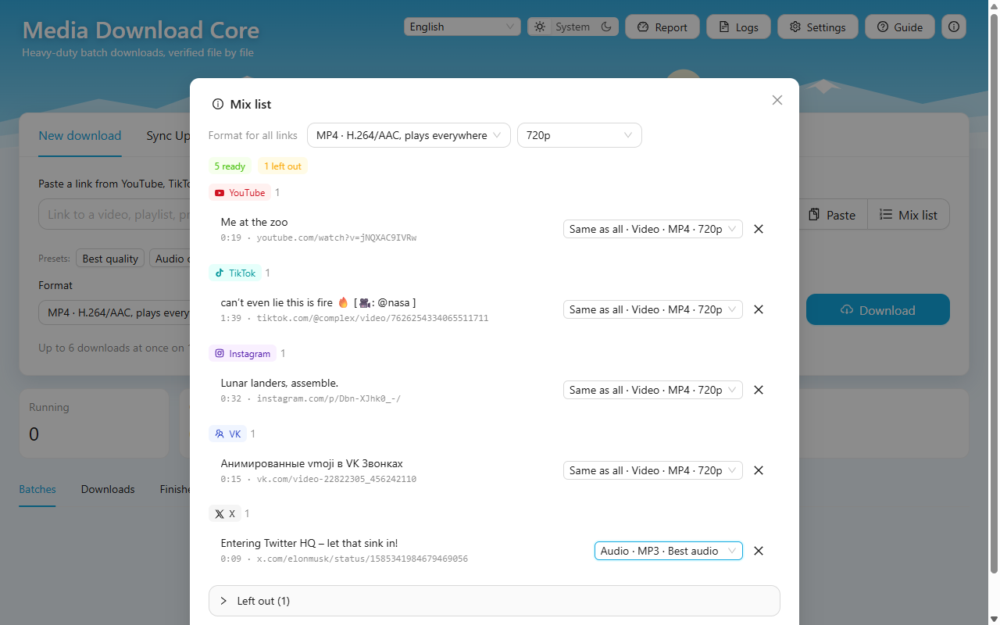

<p align="center">
  
</p>

<h1 align="center">Media Download Core</h1>

<p align="center">
  <strong>Back up whole playlists and profiles. Every file verified.</strong><br>
  A free desktop app for macOS, Windows and Linux, a <code>mdc</code> command line and a Node.js library.
</p>

<p align="center">
  <a href="https://isaachq.github.io/media-downloader-core/"><strong>Website</strong></a> ·
  <a href="https://github.com/isaachq/media-downloader-core/releases"><strong>Download</strong></a> ·
  <a href="CHANGELOG.md">Changelog</a> ·
  <a href="#documentation">Documentation</a>
</p>

<p align="center">
  
</p>

Most downloaders handle one video at a time. Media Download Core is built for a whole
playlist, a whole profile, a whole list of links — and for leaving it running while you do
something else. Paste a link, pick what you want, and it downloads hundreds of videos or
songs while it checks every single file.

## Features

- **Whole playlists and profiles** — YouTube playlists, channels and Mixes; TikTok,
  Instagram and Facebook videos, carousels and entire profiles; VK videos and playlists;
  X posts; or a link straight to a media file.
- **Pick before you download** — a preview lists everything a link holds; filter and select
  only what you want.
- **Mix list** — links of any sites gathered into one batch, with one format for all or a
  format per link (one song as MP3 among videos).
- **Every file verified** — codecs, duration, every frame decoded and a SHA-256 recorded; a
  broken file is downloaded again.
- **Built for big jobs** — up to 50,000 items in a list, batches queued back to back, an
  estimated time left from your computer's real speed, and resume after a restart.
- **Sync Up** — keep TikTok accounts in step with their folders, now or on a schedule.
- **Private by design** — no account, no ads, no telemetry. It runs on your computer and
  uses your own browser's session only when a site requires it; it never asks for a password.
- **14 languages** — Spanish, English, Portuguese, Indonesian, Hindi, Vietnamese, Thai,
  Turkish, Arabic (right to left), French, German, Russian, Chinese and Italian.

| Pick what to download | A mix list: any sites, one batch |
| --- | --- |
|  |  |
| **Downloading, with the time left** | **Everything finished, in one place** |
|  |  |

## Install

Get the installer for your system from the
**[releases page](https://github.com/isaachq/media-downloader-core/releases)** — or from the
[website](https://isaachq.github.io/media-downloader-core/), which picks the right one for your
computer.

| System | Package |
| --- | --- |
| macOS (Apple Silicon, Intel) | `.dmg` |
| Windows (x64, ARM64) | `.exe` |
| Linux (x64, ARM64) | `.AppImage`, `.deb`, `.rpm` |

On first launch the app installs yt-dlp and FFmpeg from their official sources
(checksum-verified). The betas are not signed with a paid Apple or Microsoft certificate
yet, so the system warns the first time:

- **macOS** — System Settings → Privacy & Security → **Open Anyway** (once). No button? Run
  once in Terminal: `xattr -dr com.apple.quarantine "/Applications/Media Download Core.app"`
- **Windows** — on *"Windows protected your PC"*, click **More info** → **Run anyway**.

Step by step, signing in for private content, and updates:
[desktop app guide](documentation/desktop-app.md).

## Command line and library

```bash
npm install -g media-downloader-core      # the `mdc` command line (Node 20+)
mdc setup                                 # install + verify yt-dlp and ffmpeg
mdc get "https://youtube.com/playlist?list=…" -f m4a -o ~/Music
```

```ts
import {MediaDownloader} from 'media-downloader-core'   // ESM and CommonJS, types included

await using dl = new MediaDownloader({dataDir: '/path/to/app-data'})
dl.on('job', job => console.log(job.status, job.progress.fraction))

const result = await dl.analyze('https://www.youtube.com/playlist?list=…')
if (result.kind === 'playlist') dl.addPlaylist(result, {kind: 'audio', container: 'm4a'}, '/Users/me/Music')
await dl.whenIdle()
```

Zero runtime dependencies: the engine orchestrates `yt-dlp`, `ffmpeg` and `ffprobe` on a
⌊CPUs/2⌋ pool of processes, keeps memory flat and validates every file before it is delivered.

## Documentation

| Guide | What's inside |
| --- | --- |
| [Desktop app](documentation/desktop-app.md) | Installing, signing in with your browser's session, updates, every feature |
| [Command line](documentation/cli.md) | `mdc` commands, exit codes, where the tools come from |
| [Library](documentation/library.md) | API, scheduling, mix lists, format profiles, Electron |
| [Sites](documentation/sites.md) | YouTube, <a id="youtube-attestation"></a>[YouTube attestation](documentation/sites.md#youtube-attestation), TikTok, Instagram, Facebook, Sync Up, player-page sites |
| [Architecture](documentation/architecture.md) | Retries, concurrency, heavy loads, integrity validation, errors, security |
| [Contributing](CONTRIBUTING.md) | Building from source, development and testing |
| [Changelog](CHANGELOG.md) | Every change, version by version |

## Responsible use

This is an educational project, meant for learning and for backing up content you own or are
allowed to download. Respect each site's terms of service and copyright law; you are
responsible for how you use it. Some parts exist to study how sites tell their own pages from
scripts — notably [YouTube's attestation](documentation/sites.md#youtube-attestation), which
YouTube's terms don't allow outside its page.

## Privacy

Media Download Core collects no personal data, includes no telemetry or trackers, and stores
all user data on your device. See [PRIVACY.md](PRIVACY.md) (English) or
[PRIVACY_ES.md](PRIVACY_ES.md) (Español).

## License

[PolyForm Noncommercial 1.0.0](LICENSE) — free for learning, personal and other
noncommercial use; commercial use is not permitted. Anyone who shares any part
of this software, modified or not, must include the license and this notice:

```
Required Notice: Copyright (c) 2026 isaachq <isaac.hernandez.qz@gmail.com> (https://github.com/isaachq/media-downloader-core)
```

For commercial licensing, contact isaac.hernandez.qz@gmail.com. The interface is built with
[Ant Design](https://github.com/ant-design/ant-design) (MIT); the brand is described in
[documentation/brand.md](documentation/brand.md).
